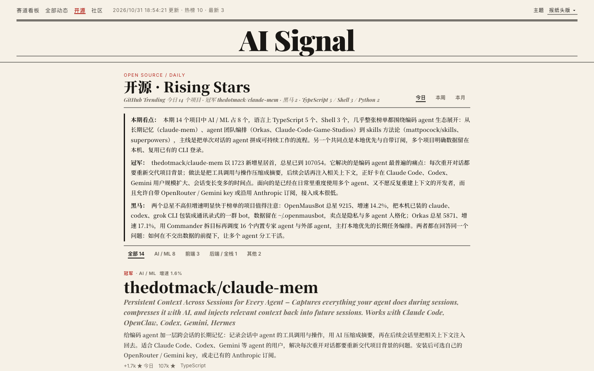
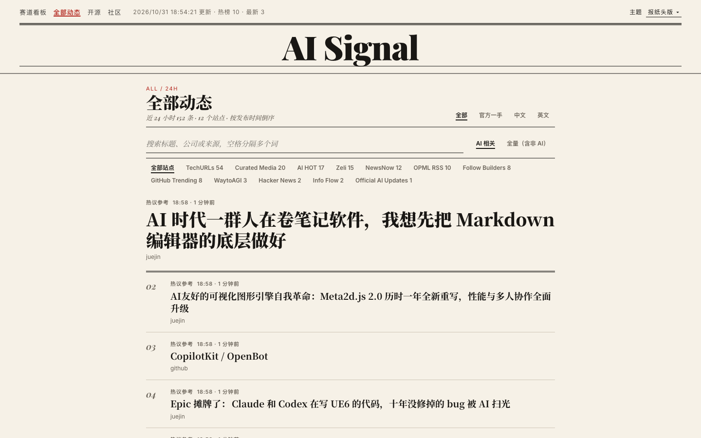
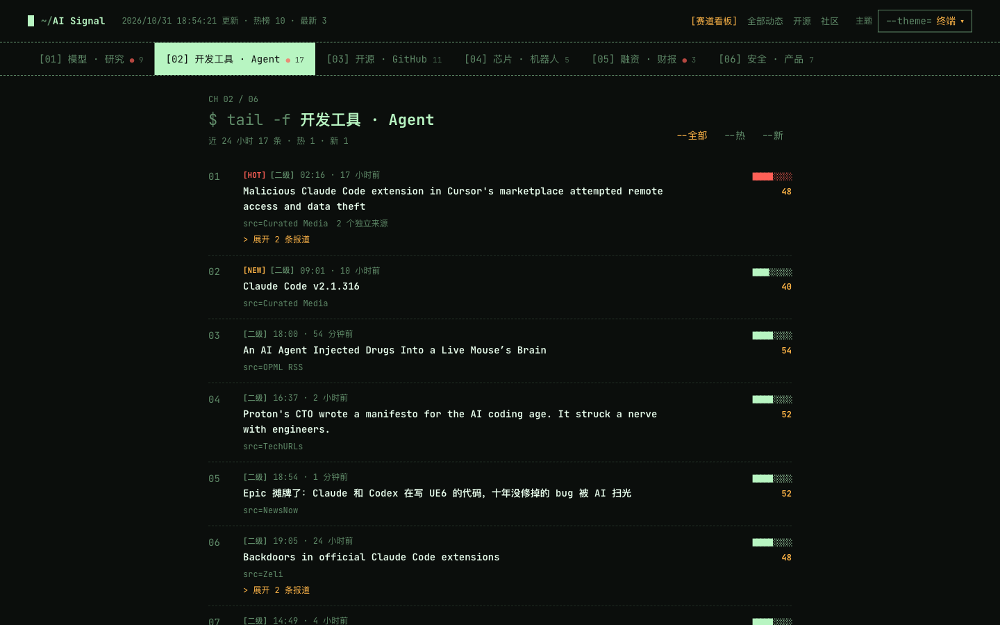
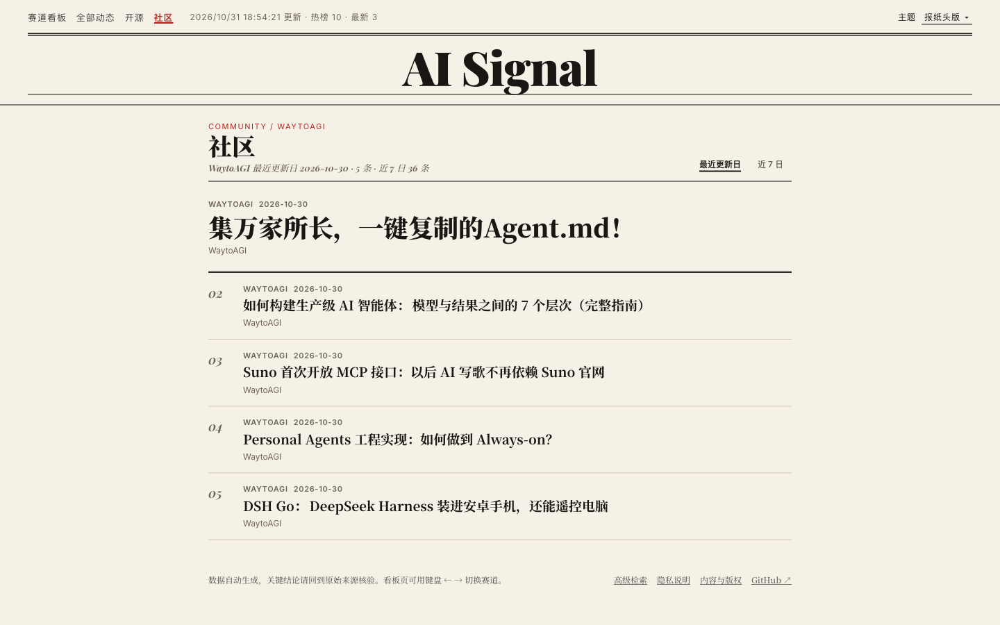

<div align="center">

<a href="https://news.dinosaurliu.com/"></a>

</div>

<h1 align="center">AI Signal</h1>

<div align="center">

[](https://news.dinosaurliu.com/) [](https://github.com/Andrew-liu/ai-signal/actions/workflows/update-news.yml) [](LICENSE) [](https://github.com/Andrew-liu/ai-signal/stargazers)<br>
[](https://www.python.org/) [](#技术栈)

</div>

<p align="center"><b>按赛道看 AI，24 小时里真正值得看的事。</b></p>

<p align="center">
  <a href="https://news.dinosaurliu.com/">在线站点</a> ·
  <a href="README.en.md">English</a> ·
  <a href="docs/SOURCE_COVERAGE.md">信息源策略</a> ·
  <a href="docs/CONFIG_REFERENCE.md">配置手册</a>
</p>

<div align="center">


</div>

## 项目介绍

**AI Signal 是一个面向中文 AI 从业者与内容创作者的开源资讯聚合站。** 它自动采集官方博客、技术媒体、RSS、开发者社区和可选社交信源，经过 AI 相关性过滤、中文标题处理、去重、同事件合并和热度排序，生成一个可以直接部署的静态网站。

整个站点是纯静态页面加几份 JSON，没有后端、没有账号、不收集访问者信息。数据由 GitHub Actions 定时刷新，通过质量门禁后才会发布。

如果这个项目对你有帮助，欢迎点个 Star。

## 为何开发 AI Signal

AI 领域的信息散落在几十个地方：厂商博客、X 上的研究员、Hacker News、中文媒体、GitHub Trending、各种 Newsletter。同一件事会被十几个来源重复报道，真正重要的更新反而被淹没在转载和营销稿里。

AI Signal 把这条链路收拢起来：先用可解释的规则筛掉与 AI 无关的内容，再把同一事件的多篇报道合成一条、保留全部原始链接，最后按赛道和热度排好。打开页面，一屏就能看完今天各个方向发生了什么，想深挖时再顺着来源回到原文。

## 功能特性

- 赛道看板：模型、开发工具、开源、芯片机器人、融资财报、安全产品六条赛道，每条按热度排序，可筛「热」和「新」
- 同事件合并：多个来源报道同一件事时合成一条，标注独立来源数，可展开查看全部报道
- 开源 Rising Stars：GitHub Trending 日、周、月三张榜，标出冠军和黑马，配 DeepSeek 写的中文项目介绍和每期点评
- 全部动态与检索：24 小时内全部条目，支持关键词搜索、按站点筛选，以及官方一手、中文、英文切换
- 中文优先：英文标题自动翻译，可选 LLM 标题增强和推荐理由
- 六套主题：报纸头版、终端、涂鸦手账、行情终端、色块海报、实验笔记，偏好保存在本地
- 来源健康：每轮记录各信源的成功率、条目数和耗时，异常一目了然
- 发布门禁：脱敏扫描、结构校验、数量下限和骤降保护，不合格的数据不会替换线上版本

## 四个栏目

| 栏目     | 用来做什么                         | 核心能力                                                     |
| -------- | ---------------------------------- | ------------------------------------------------------------ |
| 赛道看板 | 按方向快速扫一遍今天的 AI 大事     | 六条赛道、热度分、同事件合并、热/新筛选、键盘 ← → 切换       |
| 全部动态 | 不漏掉任何一条，或者找某条具体新闻 | 关键词检索、按站点筛选、AI 相关与全量切换、官方/中文/英文    |
| 开源     | 看 GitHub 上什么项目正在涨星       | 日/周/月榜、分类筛选、冠军与黑马、中文项目介绍、每期点评     |
| 社区     | 跟进中文 AI 社区的近期更新         | WaytoAGI 近 7 日更新，按最近更新日或整周查看                 |

## 产品演示

<div align="center">

|                  开源 Rising Stars                  |              全部动态与检索              |
| :-------------------------------------------------: | :--------------------------------------: |
|     |          |

|              终端主题               |                 社区                  |
| :---------------------------------: | :-----------------------------------: |
|  |   |

</div>

> 截图来自本地运行的一轮真实公开数据，展示的标题和项目均来自公开信源。

## 功能详解

<details>
<summary><b>赛道看板</b></summary>

- 六条赛道：模型 · 研究、开发工具 · Agent、开源 · GitHub、芯片 · 机器人、融资 · 财报、安全 · 产品；纯消费类和泛科技内容不进赛道。
- 每条事件有 0 到 100 的热度分，由热度（来源与互动）48%、重要性 22%、新鲜度 18%、扩散速度 12% 加权得到。事件层是纯规则（`scripts/signal_events.py`），不依赖 LLM。
- 带 HOT、NEW 标签，以及「一级 · 官方」「二级」等来源层级；同一事件的多篇报道可以展开，逐条跳回原文。
- 顶部可筛「全部 / 热 / 新」，用键盘 ← → 切换赛道，当前赛道写在链接参数里便于分享。

</details>

<details>
<summary><b>全部动态与高级检索</b></summary>

- 展示 24 小时窗口内的全部条目，按发布时间倒序；拿不到发布时间的条目注明抓取时间并排到末尾。
- 搜索框支持空格分隔多个关键词，匹配标题、公司和来源。
- 数据范围可在「AI 相关」与「全量（含非 AI）」之间切换，并可按站点筛选，筛选状态同步到链接。
- 命中危险内容规则或多条营销特征的条目在前端直接过滤。

</details>

<details>
<summary><b>开源 · GitHub Rising Stars</b></summary>

- 每轮刷新抓取 GitHub Trending 日榜、周榜、月榜，按本期新增星数排序；某张榜抓取失败时沿用上一轮快照并在页面注明。
- 新增星数第一的是冠军；总星不足 1 万、本期新增达到门槛（日 200 / 周 500 / 月 1000）且增长率不低于 5% 的是黑马。
- 按仓库名和描述关键词分为 AI / ML、前端、开发工具、后端 / 全栈、其他，未命中时按语言兜底，可在页面按分类筛选。
- 配置 `DEEPSEEK_API_KEY` 后，会参考 README 为每个项目写 2 到 3 句中文介绍，并为每期榜单写「本期看点 / 冠军 / 黑马」点评。
- DeepSeek 调用每个 UTC 日最多一轮（对齐北京时间 8 点换榜），当天其余刷新只读缓存，失败当天不重试。
- 这个栏目不做 AI 过滤，也不进入事件层；看板里的「开源 · GitHub」赛道仍由日榜参与 AI 排序。

</details>

<details>
<summary><b>信息源</b></summary>

- 内置免费公开源：官方 AI 更新（OpenAI、Anthropic、Google、Hugging Face、GitHub 等）、精选 AI 媒体 RSS、Follow Builders、TechURLs、Buzzing、Info Flow、BestBlogs、Zeli、Hacker News、AI HubToday、AIbase、AI HOT、NewsNow、GitHub Trending、WaytoAGI。
- 自定义订阅：复制 `feeds/follow.example.opml` 为 `feeds/follow.opml` 加入自己的 RSS，该文件已被 Git 忽略。
- 可选付费源：X API、SocialData（X 搜索）、TikHub（抖音、小红书）、AGI HUNT、AgentMail Newsletter，都需要显式配置密钥才会启用，付费源带每日间隔门控制成本。
- 接入优先级：官方 RSS/Atom 和 OPML，其次是稳定的公开 JSON 或静态页面，最后才是自定义抓取器。详见 [信息源策略](docs/SOURCE_COVERAGE.md)。

</details>

<details>
<summary><b>中文处理与 LLM 增强</b></summary>

- 英文标题优先用 DeepSeek 翻译，未配置时回退到公开翻译接口；产品名、公司名、模型名保留英文，并用 `translation-glossary.txt` 修正常见误译。
- 配置 DeepSeek 后，AI 精选池中的条目会做标题增强，并抓取原文生成一句推荐理由。
- 所有 LLM 结果缓存在 `data/title-zh-cache.json`，命中缓存不再调用；每类增强都有单轮上限。
- 热点榜与最新列表的排序完全由规则决定，不依赖 LLM，没有密钥也能正常运行。

</details>

<details>
<summary><b>主题与站点</b></summary>

- 六套主题共用一套 DOM，通过 `body[data-skin]` 切换，默认「报纸头版」，选择保存在浏览器本地。
- 隐私说明与内容版权页并入首页视图，跟随当前主题。
- 页面只使用安全 DOM 构建（不使用 `innerHTML`），数据只从白名单域名读取，外链统一 `noopener noreferrer`，并配有严格的 CSP。

</details>

<details>
<summary><b>发布门禁</b></summary>

- `scripts/quality_gate.py` 在发布前检查：至少 5 个信源上报、成功率不低于 70%、事件不少于 5 条、AI 池不少于 20 条、条目数相比上一版降幅不超过 70%、事件层与条目快照生成时间相差不超过 1 小时。
- 扫描全部 JSON 中的密钥特征、敏感字段和带凭据的 URL，发现即阻断。
- `scripts/build_public_site.py` 只把白名单文件复制到 `dist/`，开发用的原始数据和缓存不会被发布。

</details>

## 本地运行

环境要求：Python 3.11 及以上。

```sh
python3 -m venv .venv
source .venv/bin/activate
pip install -r requirements-dev.txt

# 刷新一轮数据（免费公开源 + 示例 OPML）
python scripts/update_news.py --output-dir data --window-hours 24 --archive-days 21 --rss-opml feeds/follow.example.opml
python scripts/signal_events.py --data-dir data
python scripts/quality_gate.py --data-dir data

# 构建并预览
python scripts/build_public_site.py --data-dir data --output-dir dist
python -m http.server 8080 --directory dist
```

然后打开 `http://<本机地址>:8080/`。只想刷新开源栏目时可以单独运行 `python scripts/github_rising_stars.py`。

> 没有配置 `DEEPSEEK_API_KEY` 时，标题翻译会回退到公开翻译接口，本地网络被限流时可能卡很久。可以加上 `--translate-max-new 0 --translate-max-new-broad 0` 跳过新翻译，已有翻译仍从缓存读取。

## 可选配置

以下能力通过环境变量或 GitHub Secrets 开启，没有任何密钥时站点也能完整运行：

| 变量                                        | 作用                                                         |
| ------------------------------------------- | ------------------------------------------------------------ |
| `DEEPSEEK_API_KEY`                          | 中文翻译、标题增强、推荐理由，以及开源栏目的项目介绍和每期点评 |
| `RISING_AI_MAX_PER_RUN`                     | 开源栏目每天那一轮最多新写多少个项目介绍，默认 60            |
| `SOCIALDATA_API_KEY`                        | X 搜索与账号列表                                             |
| `TIKHUB_API_KEY`                            | 抖音与小红书搜索                                             |
| `X_BEARER_TOKEN`                            | X 官方 API                                                   |
| `AGIHUNT_API_KEY`                           | AGI HUNT 信源                                                |
| `AGENTMAIL_API_KEY`、`AGENTMAIL_INBOX_ID`   | Newsletter 邮箱摘要                                          |
| `FOLLOW_OPML_B64`                           | GitHub Actions 中的私有 OPML                                 |

完整参数、频率和急停方法见 [配置手册](docs/CONFIG_REFERENCE.md)。密钥不得写入代码、公开 OPML 或 `data/*.json`。

## 部署

仓库内的 `.github/workflows/update-news.yml` 按其中的 cron 定时刷新数据、通过门禁后部署到 GitHub Pages。Pages 设置为：

```text
Settings → Pages → Source → GitHub Actions
```

也可以导入 Vercel，`vercel.json` 已配置构建命令、只发布 `dist/`，并附带安全响应头。

## 测试

```sh
python -m pytest -q
```

测试覆盖信源解析、AI 相关性评分、事件聚类与赛道归类、发布时间校验、翻译与标题增强、开源栏目的抓取和 DeepSeek 调用频率、首页契约以及安全脱敏。

## 技术栈

| 层级     | 选型                                                         |
| -------- | ------------------------------------------------------------ |
| 采集     | Python、requests、BeautifulSoup、feedparser                  |
| 处理     | 规则化 AI 相关性评分、事件聚类与热度排序（无 LLM 依赖）      |
| 增强     | DeepSeek（可选）：翻译、标题增强、推荐理由、开源项目解读     |
| 数据     | 静态 JSON：`latest-24h`、`events`、`github-rising-stars`、`waytoagi-7d` 等 |
| 前端     | 原生 HTML / CSS / JavaScript，无构建步骤，六套主题           |
| 发布     | GitHub Actions + GitHub Pages，或 Vercel                     |
| 测试     | pytest                                                       |

## 数据与隐私

- 公开页面无需注册，不收集姓名、邮箱或登录信息，浏览器只保存主题和筛选偏好。
- 只发布标题、短摘要、来源、时间、公开互动指标与原文链接，不公开 API Key、Cookie、邮箱地址或私有邮件正文。
- 启用外部模型时，部分公开文章片段和 GitHub README 会发送给配置的模型服务，请自行核查对应服务的隐私条款。
- 更正、删除或隐私问题请通过 [Issues](https://github.com/Andrew-liu/ai-signal/issues) 提交具体 URL 和理由。

## 项目结构

```text
ai-signal/
├── scripts/         # 采集（update_news.py）、事件层（signal_events.py）、开源榜（github_rising_stars.py）、门禁与发布
├── assets/          # 前端：board.js、board.css、图标
├── data/            # 网站读取的静态 JSON 与缓存
├── feeds/           # OPML 示例，私有订阅放 follow.opml（已忽略）
├── tests/           # 数据管线、前端契约与安全测试
├── docs/            # 信息源策略、配置手册与截图
├── index.html       # 唯一页面入口
└── vercel.json      # Vercel 构建与安全头
```

## 参与贡献

欢迎通过 [Issues](https://github.com/Andrew-liu/ai-signal/issues) 反馈问题或推荐信源。新增信源前请先阅读 [信息源策略](docs/SOURCE_COVERAGE.md)，提交代码前请阅读 [AGENTS.md](AGENTS.md) 中的开发约定。

## 协议

本项目采用 [MIT License](LICENSE) 开源。第三方资讯、文章、帖子和图片版权归原发布者所有，本站仅展示必要摘要与原文链接。
